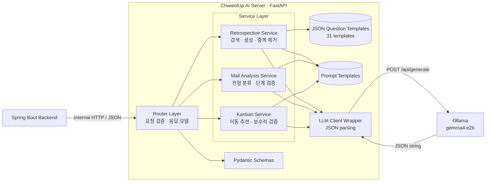

<div align="center">

# ChwieolUp AI Server

**취얼업(ChwieolUp) 취업 준비 플랫폼을 위한 로컬 LLM 기반 채용 메일 분석·회고 질문 생성 서버**

*회고 질문 생성 · 사용자 정의 전형 분류 · 칸반 이동 추천 · JSON/Pydantic 이중 검증 · Human-in-the-Loop*

<p align="center">
  
  
  
  
  
  
</p>

</div>

---

## 1. 개요 (Overview)

**ChwieolUp AI Server**는 취업 준비 플랫폼 **취얼업**의 Spring Boot 백엔드가 내부 HTTP API로 호출하는 FastAPI 기반 AI 서버입니다. 채용공고와 전형 정보로 회고 질문을 만들고, 채용 메일을 사용자가 직접 정의한 전형 단계에 분류하며, 현재 채용 카드의 칸반 이동 필요성을 추천합니다.

모든 LLM 추론은 설정된 **Ollama HTTP API**를 통해 수행됩니다. LLM의 원본 출력을 그대로 반환하지 않고 JSON 파싱, Pydantic 스키마 검증, 허용 단계 재검증, 중복 제거와 보수적 후처리를 거쳐 응답합니다.

이 서버는 실제 칸반 카드를 이동하거나 일정을 등록하지 않습니다. 모든 분류와 이동 결과는 추천이며, MVP 정책상 항상 사용자 확인이 필요합니다.

---

## 2. 주요 기능 (Key Features)

### 1) 전형 맥락 기반 회고 질문 생성

- 회사명, 채용공고명, 직무명, 전형 단계에 맞는 회고 질문을 생성합니다.
- JSON 저장소의 **31개 질문 템플릿**에서 직무와 전형이 일치하는 후보를 먼저 검색합니다.
- `all` wildcard, 부분 문자열, 토큰 교집합을 지원하며 매칭 점수와 priority 순으로 후보를 정렬합니다.
- LLM이 템플릿의 의도와 출처를 유지하면서 입력 맥락에 맞게 질문을 자연스럽게 재작성합니다.
- 중복 질문과 유효하지 않은 템플릿 출처를 제거하고, 수량이 부족하면 선별된 원본 템플릿으로 보충합니다.

### 2) 사용자 정의 전형 카테고리 분류

- 메일 제목과 본문을 사용자가 전달한 `user_stage_categories`와 비교합니다.
- 전역 고정 단계가 아닌, 요청마다 달라질 수 있는 사용자별 단계 목록을 지원합니다.
- LLM이 목록에 없는 stage ID를 반환하면 서버가 `predicted_stage: null`로 정규화합니다.
- `confidence`, `reason`, 원문 기반 `evidence`를 함께 반환하며 evidence는 최대 3개로 제한합니다.

### 3) 안전한 칸반 이동 추천

- 메일 내용, 현재 단계, 전체 칸반 단계 목록을 함께 비교해 이동 여부와 대상을 추천합니다.
- 인접 단계가 아니더라도 메일의 근거가 명확하면 이동을 추천할 수 있습니다.
- 다음 조건에서는 서버가 이동 추천을 거절하고 `to_stage: null`로 정규화합니다.
  - LLM이 이동을 추천하지 않은 경우
  - 대상이 허용 목록에 없거나 현재 단계와 같은 경우
  - `confidence < 0.7`인 경우
  - 유효한 evidence가 없는 경우

### 4) 구조화된 LLM 응답 파이프라인

- 모든 LLM 호출은 `app/core/llm_client.py`의 `generate_json_with_llm()`만 통과합니다.
- Ollama에 `format: "json"`, `stream: false`를 전달해 JSON 객체 응답을 요구합니다.
- 기능별 Pydantic response model과 서비스 후처리로 원본 LLM 응답을 다시 검증합니다.
- confidence는 `0.0~1.0` 범위로 보정하고, 액션성 응답의 `needs_user_confirmation`은 항상 `true`로 강제합니다.

### 5) 얇은 라우터와 분리된 서비스 계층

- 라우터는 요청 검증과 서비스 호출만 담당합니다.
- 회고 검색·생성·검증, 메일 분류, 칸반 추천·검증 로직을 독립 모듈로 분리했습니다.
- 프롬프트와 정적 질문 데이터를 코드 밖의 `app/prompts/`, `app/data/`에서 관리합니다.

---

## 3. 시스템 아키텍처 (Architecture)



요청 처리 흐름은 다음과 같습니다.

```text
HTTP 요청 → Pydantic 요청 검증 → Service 비즈니스 규칙
         → Ollama JSON 생성 → JSON parsing → Pydantic 응답 검증
         → 허용 목록/신뢰도/evidence 후처리 → Spring Boot 응답
```

---

## 4. 기술 스택 (Tech Stack)

| 영역 | 기술 | 역할 |
| :--- | :--- | :--- |
| **Runtime** | Python 3.11+ | AI 서버 실행 환경 |
| **API** | FastAPI, Uvicorn | HTTP API와 OpenAPI 문서 제공 |
| **Validation** | Pydantic v2, pydantic-settings | 요청·응답 스키마 및 환경 변수 검증 |
| **LLM Client** | HTTPX | Ollama `/api/generate` 동기 HTTP 호출 |
| **Local LLM** | Ollama (`gemma4:e2b`) | 회고 질문 생성, 메일 분류, 칸반 이동 판단 |
| **Template Store** | JSON | 회고 질문 템플릿 저장 및 검색 |
| **Test** | pytest, FastAPI TestClient | 서비스 로직과 API 동작 검증 |
| **Container** | Docker, Docker Compose | 재현 가능한 서버 실행 환경 |

현재 MVP에는 데이터베이스, Vector DB, 인증·인가, 실제 칸반 자동 이동 기능이 포함되지 않습니다.

---

## 5. API 목록 (API Reference)

| Method | Endpoint | 설명 |
| :---: | :--- | :--- |
| `GET` | `/health` | 서버 프로세스 상태 확인 |
| `POST` | `/ai/retrospective/questions` | 전형 맥락에 맞는 회고 질문 생성 |
| `POST` | `/ai/mail/stage-classify` | 사용자 정의 전형 목록에서 메일 단계 추측 |
| `POST` | `/ai/kanban/move-recommend` | 메일 기반 칸반 이동 여부와 대상 추천 |

서버 실행 후 다음 문서를 사용할 수 있습니다.

- Swagger UI: [http://localhost:8001/docs](http://localhost:8001/docs)
- ReDoc: [http://localhost:8001/redoc](http://localhost:8001/redoc)
- OpenAPI JSON: [http://localhost:8001/openapi.json](http://localhost:8001/openapi.json)

---

## 6. 빠른 시작 (Quick Start)

### 사전 준비 사항

- Python 3.11 이상
- [Ollama](https://ollama.com/) 설치 및 실행
- Git

### Step 1. 저장소 클론

```bash
git clone https://github.com/TEAM-ChwieolUp/ChwieolUp-AI.git
cd ChwieolUp-AI
```

### Step 2. 가상환경과 의존성 설치

macOS / Linux:

```bash
python3 -m venv .venv
source .venv/bin/activate
pip install -r requirements.txt
```

Windows PowerShell:

```powershell
python -m venv .venv
.\.venv\Scripts\Activate.ps1
pip install -r requirements.txt
```

### Step 3. Ollama 모델 준비

```bash
ollama pull gemma4:e2b
ollama serve
```

이미 Ollama가 백그라운드에서 실행 중이라면 `ollama serve`는 생략할 수 있습니다.

### Step 4. 환경 변수 설정

macOS / Linux:

```bash
cp .env.example .env
```

Windows PowerShell:

```powershell
Copy-Item .env.example .env
```

기본 설정은 다음과 같습니다.

```dotenv
OLLAMA_BASE_URL=http://localhost:11434
OLLAMA_MODEL=gemma4:e2b
OLLAMA_THINK=false
APP_ENV=local
```

| 환경 변수 | 기본값 | 설명 |
| :--- | :--- | :--- |
| `OLLAMA_BASE_URL` | `http://localhost:11434` | Ollama 서버 주소 |
| `OLLAMA_MODEL` | `gemma4:e2b` | 생성에 사용할 Ollama 모델 |
| `OLLAMA_THINK` | `false` | Ollama thinking 모드 전달 여부 |
| `APP_ENV` | `local` | 애플리케이션 실행 환경 구분 |

### Step 5. FastAPI 서버 실행

```bash
uvicorn app.main:app --host 0.0.0.0 --port 8001 --reload
```

Health check:

```bash
curl http://localhost:8001/health
```

```json
{"status":"ok"}
```

---

## 7. Docker 실행 (Docker)

```bash
docker compose up -d --build
docker compose logs -f ai-server
```

현재 Docker 이미지는 컨테이너 내부에서 `8002` 포트로 Uvicorn을 실행하고, Compose는 Ollama 접근을 위해 `network_mode: host`를 사용합니다. 따라서 Docker 실행 시 API 주소는 `http://localhost:8002`입니다.

> Docker Desktop에서 host networking을 사용할 경우 해당 기능이 활성화되어 있어야 합니다. 환경에서 host networking을 지원하지 않는다면 Compose의 네트워크/포트 설정과 `OLLAMA_BASE_URL`을 실행 환경에 맞게 조정하세요.

종료:

```bash
docker compose down
```

---

## 8. API 사용 예시 (Examples)

### 1) 회고 질문 생성

```bash
curl -X POST http://localhost:8001/ai/retrospective/questions \
  -H "Content-Type: application/json" \
  -d '{
    "user_id": 1,
    "job_posting_title": "카카오 백엔드 개발자 채용",
    "company_name": "카카오",
    "job_role": "백엔드 개발자",
    "process_stage": "1차 기술면접",
    "question_count": 4
  }'
```

응답 예시:

```json
{
  "question_set_title": "백엔드 기술면접 회고 질문",
  "job_role": "백엔드 개발자",
  "process_stage": "1차 기술면접",
  "questions": [
    {
      "category": "technical_depth",
      "question": "카카오 백엔드 기술면접에서 가장 답변이 부족했던 기술 개념은 무엇이었나요?",
      "reason": "보완이 필요한 기술 영역을 구체화하기 위한 질문입니다.",
      "priority": "high",
      "source_template_ids": ["q_backend_interview_001"]
    }
  ]
}
```

`question_count`는 1~10 사이에서 지정할 수 있습니다. `job_role`과 `process_stage`는 자유 텍스트이며 템플릿 매칭에 사용됩니다.

### 2) 메일 전형 카테고리 추측

```bash
curl -X POST http://localhost:8001/ai/mail/stage-classify \
  -H "Content-Type: application/json" \
  -d '{
    "mail_subject": "[카카오] 1차 인터뷰 일정 안내",
    "mail_body": "카카오 채용팀입니다. 1차 기술 인터뷰 일정을 안내드립니다.",
    "user_stage_categories": [
      {"id": 1, "name": "서류", "description": "서류 심사", "order": 1},
      {"id": 2, "name": "코딩테스트", "description": "온라인 테스트", "order": 2},
      {"id": 3, "name": "1차 면접", "description": "기술 또는 실무진 면접", "order": 3}
    ]
  }'
```

응답 예시:

```json
{
  "predicted_stage": {"id": 3, "name": "1차 면접", "order": 3},
  "confidence": 0.91,
  "reason": "메일에 1차 기술 인터뷰 일정이 명시되어 있습니다.",
  "evidence": ["1차 인터뷰 일정 안내", "1차 기술 인터뷰 일정을 안내드립니다"],
  "needs_user_confirmation": true
}
```

분류할 근거가 부족하거나 LLM이 허용 목록 밖의 단계를 반환하면 `predicted_stage`는 `null`이 됩니다.

### 3) 칸반 이동 추천

```bash
curl -X POST http://localhost:8001/ai/kanban/move-recommend \
  -H "Content-Type: application/json" \
  -d '{
    "mail_subject": "[카카오] 최종 인터뷰 일정 안내",
    "mail_body": "최종 인터뷰 일정을 안내드립니다.",
    "current_kanban_stage": {
      "id": 2, "name": "코딩테스트", "description": "온라인 코딩테스트", "order": 2
    },
    "user_kanban_stages": [
      {"id": 1, "name": "서류", "description": "서류 검토", "order": 1},
      {"id": 2, "name": "코딩테스트", "description": "온라인 코딩테스트", "order": 2},
      {"id": 3, "name": "1차 면접", "description": "실무진 면접", "order": 3},
      {"id": 4, "name": "최종 면접", "description": "임원 또는 최종 인터뷰", "order": 4}
    ]
  }'
```

응답 예시:

```json
{
  "recommend_move": true,
  "from_stage": {
    "id": 2, "name": "코딩테스트", "description": "온라인 코딩테스트", "order": 2
  },
  "to_stage": {
    "id": 4, "name": "최종 면접", "description": "임원 또는 최종 인터뷰", "order": 4
  },
  "confidence": 0.88,
  "reason": "메일 본문에 최종 인터뷰 일정이 명시되어 있습니다.",
  "evidence": ["최종 인터뷰 일정을 안내드립니다"],
  "needs_user_confirmation": true
}
```

---

## 9. 검증 및 안전 정책 (Validation & Safety)

| 항목 | 서버 정책 |
| :--- | :--- |
| 빈 메일 본문 | 요청 스키마 또는 서비스에서 거절 |
| 빈 stage 목록 | 요청 스키마 또는 서비스에서 거절 |
| 현재 칸반 단계가 전체 목록에 없음 | `400 Bad Request` |
| 목록에 없는 LLM 예측 단계 | 메일 분류는 `null`, 칸반 추천은 이동 없음으로 정규화 |
| 현재 단계와 동일한 이동 대상 | `recommend_move: false`, `to_stage: null` |
| 칸반 confidence 0.7 미만 | 이동 추천 거절 |
| 칸반 evidence 없음 | 이동 추천 거절 |
| confidence 범위 이탈 | `0.0~1.0`으로 보정 |
| evidence | 공백 제거 후 최대 3개만 반환 |
| 사용자 확인 | `needs_user_confirmation: true` 강제 |

FastAPI/Pydantic 요청 검증 오류는 `422 Unprocessable Entity`, 서비스 비즈니스 검증 오류는 `400 Bad Request`로 반환됩니다.

---

## 10. 테스트 (Testing)

LLM 호출은 테스트에서 monkeypatch로 대체하므로 Ollama가 실행 중이지 않아도 단위/API 테스트를 수행할 수 있습니다.

```bash
pytest -q
```

현재 저장소에는 총 **20개 테스트 케이스**가 있으며 다음 동작을 검증합니다.

- 회고 템플릿의 정확 매칭과 `all` wildcard
- 사용자 정의 전형명 매칭과 priority 정렬
- 요청 수량 보정, 중복 질문 제거, 응답 스키마 검증
- 면접·코딩테스트 메일 분류와 모호한 메일 처리
- 허용되지 않은 stage 제거, confidence 보정, evidence 개수 제한
- 동일 단계와 낮은 신뢰도 이동 거절
- 비인접 칸반 단계 이동 허용
- 현재 칸반 단계의 목록 포함 여부 검증
- `needs_user_confirmation: true` 강제

---

## 11. 프로젝트 구조 (Project Structure)

```text
ChwieolUp-AI/
├─ app/
│  ├─ main.py                         # FastAPI 앱, health check, router 등록
│  ├─ core/
│  │  ├─ config.py                    # .env 및 환경 변수 설정
│  │  ├─ llm_client.py                # 유일한 Ollama 호출 진입점
│  │  └─ errors.py                    # 공통 애플리케이션 오류 확장 지점
│  ├─ routers/
│  │  ├─ retrospective.py             # 회고 질문 API
│  │  ├─ mail_stage.py                # 메일 전형 분류 API
│  │  └─ kanban.py                    # 칸반 이동 추천 API
│  ├─ schemas/
│  │  ├─ retrospective.py             # 회고 요청·응답·템플릿 모델
│  │  ├─ mail_stage.py                # 메일 분류 요청·응답 모델
│  │  └─ kanban.py                    # 칸반 추천 요청·응답 모델
│  ├─ services/
│  │  ├─ retrospective/
│  │  │  ├─ service.py                # 회고 파이프라인 오케스트레이션
│  │  │  ├─ template_loader.py        # JSON 템플릿 캐시 로딩
│  │  │  ├─ retriever.py              # 직무·전형 템플릿 검색/정렬
│  │  │  ├─ generator.py              # 회고 LLM 요청 및 응답 검증
│  │  │  └─ validator.py              # 중복 제거와 질문 수 보정
│  │  ├─ mail_analysis/
│  │  │  ├─ service.py                # 단계 허용 목록 및 응답 후처리
│  │  │  ├─ classifier.py             # 메일 분류 LLM 호출
│  │  │  └─ extractor.py              # 공통 메일 신호 추출 확장 지점
│  │  └─ kanban/
│  │     ├─ service.py                # 칸반 추천 오케스트레이션
│  │     ├─ recommender.py            # 칸반 추천 LLM 호출
│  │     └─ validator.py              # 신뢰도·근거·단계 검증
│  ├─ data/
│  │  └─ retrospective_questions.json # 31개 회고 질문 템플릿
│  └─ prompts/
│     ├─ retrospective_prompt.txt
│     ├─ mail_stage_classification_prompt.txt
│     └─ kanban_move_recommendation_prompt.txt
├─ tests/
│  ├─ test_retrospective.py
│  ├─ test_mail_stage.py
│  └─ test_kanban.py
├─ .env.example
├─ requirements.txt
├─ Dockerfile
├─ docker-compose.yml
├─ AGENTS.md
└─ README.md
```

---

## 12. 개발 원칙 (Development Principles)

- **얇은 라우터**: route handler에는 비즈니스 로직을 두지 않습니다.
- **명시적 스키마**: 외부 요청과 응답은 모두 Pydantic model로 정의합니다.
- **단일 LLM 경계**: Ollama 호출은 `app/core/llm_client.py`를 통해서만 수행합니다.
- **LLM 불신 원칙**: 생성 결과를 그대로 노출하지 않고 JSON parsing, schema validation, 도메인 검증을 거칩니다.
- **사용자 정의 단계 존중**: 분류와 이동 대상은 요청으로 전달된 목록 안에서만 선택합니다.
- **Human-in-the-Loop**: AI는 추천만 제공하며 실제 상태 변경은 사용자 확인 이후 백엔드가 담당합니다.
- **확장 가능한 모듈 경계**: 향후 DB, Vector DB, RAG 또는 다른 모델을 도입할 수 있도록 검색·생성·검증을 분리합니다.

---

## 13. 향후 확장 방향 (Roadmap)

1. 회고 질문 템플릿을 PostgreSQL로 이전
2. Qdrant 또는 Chroma 기반 질문 검색/RAG 도입
3. 사용자 과거 회고 이력 기반 개인화
4. 메일의 일정 후보와 이벤트 유형 추출
5. 캘린더 등록 추천 API 추가
6. LLM Judge 기반 응답 품질 평가
7. 사용자 피드백 기반 템플릿 priority 조정
8. 일부 분류 작업의 fine-tuning 모델 적용

---

## 14. 프로젝트 문서 (Documentation)

- [AGENTS.md](./AGENTS.md): 프로젝트 목표, API 계약, 계층 구조, 구현 및 테스트 원칙
- [`.env.example`](./.env.example): 로컬 Ollama 연결을 위한 환경 변수 예시

라이선스 정책은 아직 저장소에 명시되어 있지 않습니다. 외부 사용 또는 배포 전 프로젝트 소유자에게 이용 조건을 확인하세요.
